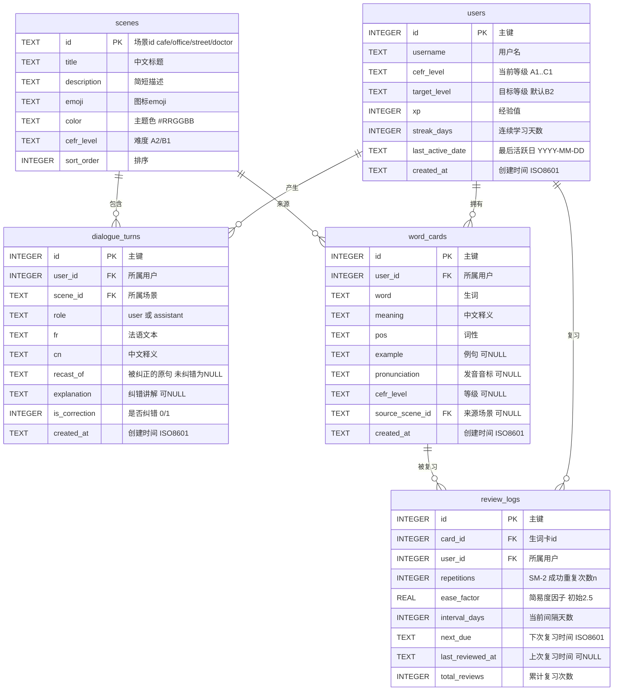
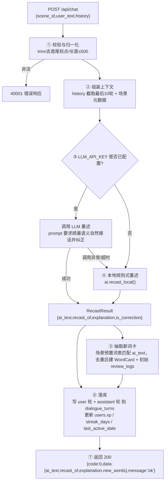

# 呀呀法语（YaYa French）架构契约 v1.0

> 本文是后端、前端两位同事的**共同且唯一输入**，所有字段名、路径、格式均须逐字实现，不得自行改名。
> 目标：零外部依赖即可本地跑通；保留从「原型」平滑演进到「正式版」的接口边界。
> 日期：2026-11-17　读者：后端工程师、前端工程师、产品经理。

---

## 0. 全局约定（先读）

| 约定 | 规则 |
|------|------|
| JSON 字段命名 | 一律 `snake_case`（小写下划线） |
| 日期/时间 | 一律 ISO8601。日期时间 `YYYY-MM-DDTHH:MM:SSZ`（UTC），纯日期 `YYYY-MM-DD` |
| 空值 | 用 JSON `null`，不要空字符串、不要 `undefined`、不要省略字段 |
| 布尔 | 用 JSON `true/false`（落库 SQLite 用 INTEGER 0/1，出入参转成 bool） |
| 角色取值 | 仅 `"user"` / `"assistant"` 两个字符串（不要 `me`/`bot`） |
| 评分取值 | rating 仅整数 `1/2/3/4`（1=again 2=hard 3=good 4=easy） |
| 统一响应包裹 | 所有 `/api/*` 返回 `{ "code": int, "data": object\|null, "message": string }`，成功 `code=0`、`message="ok"` |

> 前端注意：原 `demo.html` 里的 `role:'me'/'bot'` 在正式接口中改为 `'user'/'assistant'`，`fr/cn` 字段沿用。

---

## 1. 架构分层

```
┌────────────────────────── 浏览器前端（frontend/）──────────────────────────┐
│  index.html / styles.css / app.js                                          │
│  - 场景 / 对话 / 生词卡 / 记忆账本 UI                                       │
│  - Web Speech API(ASR, fr-FR)  +  SpeechSynthesis(TTS, fr-FR)              │
│  - 通过 fetch 调用 /api/*，不直接碰数据库                                  │
└───────────────────────────────┬────────────────────────────────────────────┘
                                │ HTTP JSON（同源，后端托管静态文件）
┌───────────────────────────────▼────────────────────────────────────────────┐
│  API 层（backend/app.py）                                                   │
│  - 路由分发、CORS、请求校验、统一响应包裹、静态文件托管                     │
└───────────────┬────────────────────────────────┬───────────────────────────┘
                │                                │
┌───────────────▼──────────────┐   ┌─────────────▼──────────────────────────┐
│  领域服务层                   │   │  外部能力（可失败、可降级）              │
│  - ai.py   重述引擎           │◄──┤  - OpenAI 兼容 LLM（可选，读环境变量）   │
│  - srs.py  SM-2 复习调度      │   │  - 无 key / 调用失败 → 本地规则式重述    │
└───────────────┬──────────────┘   └────────────────────────────────────────┘
                │
┌───────────────▼───────────────────────────────────────────────────────────┐
│  数据层（backend/db.py + SQLite 文件 backend/data/yaya.db）                │
│  - 标准库 sqlite3，纯 SQL，无 ORM；seed.py 首次启动灌入原型数据             │
└───────────────────────────────────────────────────────────────────────────┘
```

分层职责边界：
- 前端只发 HTTP，不含业务规则；ASR/TTS 只用浏览器能力。
- API 层只做「校验 → 调领域服务 → 包响应」，不写业务逻辑。
- 领域服务不碰 HTTP，只接受普通 Python 值。
- 数据层只被 API 层 / 领域服务通过 `db.py` 访问，禁止在别处拼接 SQL 连接。

---

## 2. 技术栈锁定（含取舍理由，务必遵守）

| 层次 | 锁定选型 | 取舍理由（一句） |
|------|----------|------------------|
| 后端运行时 | Python 3 + FastAPI + uvicorn | 单文件即可启动、自带 OpenAPI 文档、异步友好，原型迭代最快。 |
| 数据库 | SQLite，标准库 `sqlite3`，**不引入 ORM** | Python 自带零依赖、单文件便于分发 demo，SQL 直接可控无需迁移工具。 |
| 前端 | 原生 HTML/CSS/JS，沿用 demo 零构建思路 | 浏览器直开、无 npm/打包，降低环境与协作门槛。 |
| 前后端通信 | `fetch` + JSON，后端同时托管静态文件 | 同源部署省去 CORS 复杂度（开发期另配），前端只关心 API 契约。 |
| 复习引擎 | 内置 **SM-2 简化版**（`srs.py`） | 轻量无依赖、易替换；接口隔离为 `schedule(rating,state)->state`，后续可换 py-fsrs/ts-fsrs 而不改 API。 |
| 可替换性接口 | `srs.py` 暴露 `schedule()`，数据结构为 `{repetitions,ease_factor,interval_days}` | 让 FSRS 替换只动一个文件，API 契约不变。 |
| ASR | 浏览器 Web Speech API，`lang='fr-FR'` | 浏览器内置、零后端成本，Chrome/Edge 支持良好。 |
| TTS | 浏览器 `SpeechSynthesis`，`lang='fr-FR'` | 同上零依赖，配合 `speechSynthesis.speak()` 朗读 AI 重述。 |
| LLM 重述 | OpenAI 兼容 API，读环境变量 `LLM_API_KEY` / `LLM_BASE_URL` / `LLM_MODEL` | 兼容多家供应商、切换成本低；**无 key 必须自动降级本地规则式重述**，保证离线可跑。 |
| 降级重述 | `ai.py` 内置规则表（从 demo 的 4 场景错误样例抽取） | 离线也能完整演示「说错→自然重述→继续对话」的核心体验。 |

**依赖锁死**：`backend/requirements.txt` 仅两行（`fastapi`、`uvicorn`）。任何新增依赖须先与架构师确认。

---

## 3. 数据模型

### 3.1 ER 图



### 3.2 字段语义补充（前后端逐字对齐）

- `dialogue_turns.fr`：无论角色都存**法语文本**。当 `role='user'` 时，它是**用户原句**；当 `role='assistant'` 且 `is_correction=1` 时，它是**AI 重述后的正确说法**，此时 `recast_of` 存被纠正的用户原句。
- `dialogue_turns.cn`：该句对应的中文，供前端气泡下方灰色小字展示。
- 唯一约束（防重复建卡）：`word_cards(user_id, word)` 唯一。建卡前先查重。
- 每张卡对应一条 `review_logs`；建卡时同步插入初始复习记录（`repetitions=0, ease_factor=2.5, interval_days=0, next_due=当前时间`）。

---

## 4. 统一响应、错误码与数据对象

### 4.1 响应包裹

成功：
```json
{ "code": 0, "data": { "...": "..." }, "message": "ok" }
```
失败：
```json
{ "code": 40001, "data": null, "message": "缺少必填字段 scene_id" }
```

### 4.2 业务错误码 ↔ HTTP 状态码

| code | HTTP | 含义 |
|------|------|------|
| 0 | 200 | 成功 |
| 40001 | 400 | 请求参数缺失或格式错误（含 rating 越界、空 user_text） |
| 40401 | 404 | 资源不存在（scene_id / card id 未找到） |
| 50001 | 500 | 服务内部错误（兜底，前端展示友好提示） |

> 健康检查 `GET /api/health` 成功也用包裹：`data={ "status":"ok", "version":"1.0.0", "time":"ISO8601" }`。

### 4.3 CORS 要求

`app.py` 必须挂载 `CORSMiddleware`：
```python
allow_origins=["*"],        # 原型阶段放开；生产收紧为具体域名
allow_credentials=False,    # 与 "*" 配套
allow_methods=["GET", "POST", "OPTIONS"],
allow_headers=["*"],
```
静态资源与 API 同源（都由 uvicorn 提供），CORS 主要为前端 dev server 场景准备。

### 4.4 可复用数据对象（Schemas，唯一字段定义）

**Scene**（场景列表元素）
| 字段 | 类型 | 说明 |
|------|------|------|
| id | string | cafe / office / street / doctor |
| title | string | 如「在咖啡馆点单」 |
| description | string | 如「日常交流」 |
| emoji | string | 如「☕」 |
| color | string | 如「#FBEDE5」 |
| cefr_level | string | A2 / B1 |
| sort_order | int | 排序序号 |

**DialogueTurn**（对话消息，起始对话 / 历史都用这个结构）
| 字段 | 类型 | 说明 |
|------|------|------|
| id | int\|null | 落库后才有；未落库（如 start_dialogue）为 null |
| role | string | 仅 `"user"` / `"assistant"` |
| fr | string | 法语文本 |
| cn | string | 中文释义 |
| recast_of | string\|null | 被纠正的原句，未纠错为 null |
| explanation | string\|null | 纠错讲解，可 null |
| is_correction | bool | 是否发生纠错 |
| created_at | string\|null | ISO8601，未落库为 null |

**WordCard**（生词卡）
| 字段 | 类型 | 说明 |
|------|------|------|
| id | int | 卡片主键 |
| word | string | 生词（如「la gare」） |
| meaning | string | 中文释义（如「火车站」） |
| pos | string | 词性（n.m./n.f./adj./adv./loc. 等） |
| example | string\|null | 例句 |
| pronunciation | string\|null | 发音/音标 |
| cefr_level | string\|null | 等级，未知为 null |
| source_scene_id | string\|null | 来源场景 id |
| created_at | string | ISO8601 |

**ReviewResult**（复习结果）
| 字段 | 类型 | 说明 |
|------|------|------|
| next_due | string | 下次复习时间，ISO8601 日期时间 |
| interval_days | int | 距下次复习的间隔天数 |

**ChatResult**（`POST /api/chat` 的 `data`）
| 字段 | 类型 | 说明 |
|------|------|------|
| ai_text | string | 本轮 AI 的法语输出（对应落库 `DialogueTurn.fr`，assistant 轮） |
| recast_of | string\|null | 被纠错的句子；未纠错为 null |
| explanation | string\|null | 中文纠错讲解；未纠错为 null |
| new_words | WordCard[] | 本轮新生成的生词卡数组，无则 `[]` |

---

## 5. REST API 契约（前后端共同输入）

Base URL：`http://localhost:8000`。所有路径前缀 `/api`。

### 5.1 端点总览

| # | 方法 | 路径 | 请求体 | 成功响应 `data` | 错误码 |
|---|------|------|--------|------------------|--------|
| 1 | GET | `/api/scenes` | 无 | `Scene[]` | 50001(500) |
| 2 | GET | `/api/scenes/{scene_id}` | 路径参数 `scene_id:string` | `SceneDetail`（Scene 字段 + `start_dialogue: DialogueTurn[]`） | 40401(404), 50001(500) |
| 3 | POST | `/api/chat` | `{scene_id, user_text, history}` | `ChatResult` | 40001(400), 40401(404), 50001(500) |
| 4 | GET | `/api/cards` | Query 可选 `scene_id:string` | `WordCard[]` | 50001(500) |
| 5 | POST | `/api/cards/{id}/review` | 路径参数 `id:int`，Body `{rating}` | `ReviewResult` | 40001(400), 40401(404), 50001(500) |
| 6 | GET | `/api/profile` | 无 | `UserProfile` | 50001(500) |
| 7 | GET | `/api/review/due` | Query 可选 `limit:int`(1..100,默认20) `offset:int`(≥0,默认0) | `{items:DueCard[], total, today_count}` | 40001(400) |
| 8 | GET | `/api/achievements` | 无 | `{items:Achievement[], unlocked_count, new_unlocked:string[]}` | 50001(500) |
| 9 | GET | `/api/roadmap` | 无 | `{items:RoadmapVersion[], current_version, done_count, total}` | 50001(500) |
| 10 | GET | `/api/retention` | 无 | `{continue_last, daily_goals, streak, micro_progress}` | 50001(500) |
| 11 | GET | `/api/feedback/categories` | 无 | `{code,label}[]` | 50001(500) |
| 12 | POST | `/api/feedback` | `{category, content, contact?}` | `{id:int}` | 40001(400) |
| 13 | GET | `/api/feedback/summary` | 无 | `{total, by_category:[{category,label,count}], recent:[...]}` | 50001(500) |
| 14 | GET | `/api/health` | 无 | `{status, version, time}` | 50001(500) |

### 5.2 逐端点详解

#### 1) GET `/api/scenes` — 场景列表
- 请求：无。
- 响应 `data`：`Scene[]`，按 `sort_order` 升序。
- 示例：
```json
{ "code":0, "data":[ {"id":"cafe","title":"在咖啡馆点单","description":"日常交流","emoji":"☕","color":"#FBEDE5","cefr_level":"A2","sort_order":1} ], "message":"ok" }
```

#### 2) GET `/api/scenes/{scene_id}` — 场景详情（含起始对话）
- 路径参数：`scene_id`（cafe/office/street/doctor）。
- 响应 `data`：一个 `Scene` 的所有字段，外加 `start_dialogue: DialogueTurn[]`（3~5 轮，来自 seed）。
- 起始对话的 `id=null, recast_of=null, explanation=null, is_correction=false, created_at=null`；`role` 与 `fr/cn` 按 seed 内容。
- 错误：`scene_id` 不存在 → 40401 / HTTP 404。

#### 3) POST `/api/chat` — 重述式对话（核心）
- 请求体：
```json
{ "scene_id": "cafe", "user_text": "Je veux un thé.", "history": [ /* DialogueTurn[]，可为空数组 */ ] }
```
  - `scene_id`：string，必填，须存在。
  - `user_text`：string，必填，trim 后非空，长度 ≤ 500。
  - `history`：`DialogueTurn[]`，可为空；后端只取最后 10 轮用于上下文。
- 响应 `data`：`ChatResult`（见 4.4）。
- 错误：`user_text` 空/缺字段 → 40001；`scene_id` 不存在 → 40401；LLM 与降级均异常 → 50001。
- 行为：见第 7 节状态机。无论是否纠错都返回 200（纠错不是错误）。

#### 4) GET `/api/cards` — 生词卡列表
- Query：可选 `scene_id`（给出则按 `source_scene_id` 过滤，不给则返回当前用户全部）。
- 响应 `data`：`WordCard[]`，按 `created_at` 倒序（新卡在前）。

#### 5) POST `/api/cards/{id}/review` — 提交复习评分
- 路径参数：`id`（int，卡片主键）。
- 请求体：`{ "rating": 3 }`，rating ∈ {1,2,3,4}。
- 响应 `data`：`{ "next_due":"2026-11-18T09:30:00Z", "interval_days":1 }`。
- 逻辑：调用 `srs.schedule(rating, 当前review_logs状态)` → 更新该卡的 `review_logs`（`repetitions/ease_factor/interval_days/next_due/last_reviewed_at/total_reviews`）。
- 错误：rating 非 1~4 或非整数 → 40001；卡片不存在 → 40401。

#### 9) GET `/api/roadmap` — 面客建设里程图（TASK-0059）
- 响应 `data`：`{ items: RoadmapVersion[], current_version, done_count, total }`。`RoadmapVersion` = `{version,title,theme,status,date,desc,features}`；`status ∈ done/active/planned`，planned 时 `date=null`。
- 数据源为服务端常量 `app.py:ROADMAP_DEFS`（唯一维护点），零数据库；前端只读渲染。改常量 status/date 即点亮，需重启服务生效。`done_count` = status==done 条数；`current_version` = 首个 active，无则最后一个 done。
- 维护说明见 `docs/ROADMAP.md`。

#### 10) GET `/api/retention` — 留存激励聚合（TASK-0060）
- 响应 `data`：`{ continue_last, daily_goals, streak, micro_progress }`，纯读现有表、零新表/字段（UX_PROGRESS_PLAN §D）。
  - `continue_last`：`{text_id,cefr_level,title,created_at} | null`，来自最近一篇已读（= `last_read_text`），无则不弹"接着上次"钩子。
  - `daily_goals`：`{read:{done,count,target,label}, review:{...}, chat:{...}}`，今日真实行为计数（读≥1 / 复习≥3 / 对话≥1），"今日"按 UTC 日起点 `YYYY-MM-DDT00:00:00Z` 过滤。
  - `streak`：`{days, tone}`，days 直接读 `users.streak_days`（跨天规则由 `update_user_activity` 维护）；tone 为温和正向文案，禁负面词。
  - `micro_progress`：`{words_this_week,words_last_week,reads_this_week,reads_last_week,level_trend}`，本周=近 7 天、上周=前 7-14 天；`level_trend ∈ up/flat`（读 `skill_profile` 快照 trend）。
- 无参数；失败前端静默降级、不施压。打开即弹浮层与"当天不再弹"由前端 localStorage 管理，不落库。

#### 11-13) 使用反馈（TASK-0062）
- `GET /api/feedback/categories`：`{code,label}[]`，前端浮层懒拉，前后端单一数据源（`db.FEEDBACK_CATEGORIES`）。
- `POST /api/feedback`：Body `{category, content, contact?}`；`category` 必须是预设方向 code、`content` 去空白非空且 ≤1000 字、`contact` ≤200 字，否则 40001；成功返回 `{id}`。写 `feedback` 表（user_id 当前固定 1）。
- `GET /api/feedback/summary`：`{total, by_category:[{category,label,count}], recent:[...]}`；`by_category` 覆盖全部预设方向（含 0）并按 count 降序，`recent` 最近 20 条原文。规划新版本前先看此端点，详见 `docs/FEEDBACK.md`。当前无鉴权，面客多人使用前须加管理端鉴权（含用户文本与联系方式）。

#### 8) GET `/api/achievements` — 成就列表（TASK-0058）
- 响应 `data`：`{ items: Achievement[], unlocked_count, new_unlocked }`。`Achievement` = `{code, name_zh, desc_zh, earned_at, unlocked}`；未解锁时 `earned_at=null, unlocked=false`（灰态）。
- 判定源全为已落库真实事件（对话轮/生词卡/复习达标/attempts/streak），服务端常量不下放前端（防伪造）。读时懒判定：满足阈值且未解锁 → `INSERT OR IGNORE` 落库（UNIQUE user_id+code 幂等），本次新解锁在**同事务**内 +XP（当前 +20/个，待 PM 冻结）。`new_unlocked` 为本次新解锁 code 列表。
- 不弹窗、不推送，仅进入成长页时拉取。

#### 7) GET `/api/review/due` — 到期复习队列（TASK-0057）
- Query：可选 `limit`（1..100，默认 20）、`offset`（≥0，默认 0）；越界/非整数 → 40001。
- 响应 `data`：`{ items: DueCard[], total, today_count }`。`DueCard` = `WordCard` 全字段 + `review_state:{repetitions,ease_factor,interval_days,next_due,total_reviews}`。
- 口径：`review_logs.next_due <= now` 且属当前用户，按最早到期优先（`ORDER BY next_due, id`）；`total/today_count` 与 `get_profile().stats.due_cards_count` 同口径。仅进入复习入口时拉取，不推送、无倒计时/红点。复习写入仍走 `POST /api/cards/{id}/review`，`srs.schedule()` 自动推进 next_due。

#### 6) GET `/api/profile` — 用户档案
- 响应 `data`：`UserProfile`
| 字段 | 类型 | 说明 |
|------|------|------|
| id | int | 用户主键（原型阶段固定返回 seed 用户，id=1） |
| username | string | 用户名 |
| cefr_level | string | 当前等级（seed：A2） |
| target_level | string | 目标等级（seed：B2） |
| xp | int | 经验值 |
| streak_days | int | 连续学习天数（seed：12） |
| last_active_date | string | 纯日期 YYYY-MM-DD |
| stats | object | `{ "due_cards_count":int, "new_words_week":int, "mastered_count":int, "accuracy":number }` |

#### 7) GET `/api/health` — 健康检查
- 响应 `data`：`{ "status":"ok", "version":"1.0.0", "time":"2026-11-17T09:30:00Z" }`。

---

## 6. 目录结构与启动

```
french-learner/
├── backend/
│   ├── app.py             # FastAPI 入口：路由、CORS、请求校验、统一响应包裹、静态托管
│   ├── db.py              # sqlite3 连接、建表 DDL、通用 CRUD、连接管理
│   ├── srs.py             # SM-2 简化版：schedule(rating, state) -> 新 state + next_due
│   ├── ai.py              # 重述引擎：LLM 客户端 + 规则式降级，统一入口 recast(scene_id,user_text,history)
│   ├── seed.py            # 首次启动灌入：默认用户 + 4 场景 + 起始对话 + 生词卡
│   ├── requirements.txt   # 仅 fastapi、uvicorn 两行
│   └── data/              # 运行时生成，放 yaya.db（加入 .gitignore）
└── frontend/
    ├── index.html         # 页面结构，由 demo.html 迁移
    ├── styles.css         # 样式，由 demo.html 的 <style> 抽出
    └── app.js             # 交互逻辑：fetch 调 /api/* + Web Speech ASR/TTS，由 demo.html 的 <script> 改造
```

### 6.1 静态托管路径映射

| 请求 | 返回 |
|------|------|
| `GET /` | `frontend/index.html` |
| `GET /styles.css` | `frontend/styles.css` |
| `GET /app.js` | `frontend/app.js` |
| `GET /api/*` | FastAPI JSON 路由（**先声明 API 路由，再挂载静态目录**，确保 `/api` 不被静态接管） |
| 其他静态资源 | `frontend/` 下同名文件 |

实现提示：`app.mount("/", StaticFiles(directory="../frontend", html=True), name="static")`，路径相对 `backend/`。

### 6.2 默认端口与启动命令

```bash
cd tools/french-learner/backend
pip install -r requirements.txt
uvicorn app:app --reload --host 0.0.0.0 --port 8000
```
浏览器打开 `http://localhost:8000/`。启动流程：建表（若不存在）→ 若为空库执行 `seed.py` → 提供服务。

---

## 7. 重述对话状态机

一次 `user_text` 进入后的完整链路：



关键流程说明：
1. **校验**：`user_text` trim、去首尾标点；空或超长直接 40001。
2. **上下文**：`history` 只取最后 10 轮，降低 token 与延迟。
3. **是否含错**：由 LLM 判断（prompt 明确「不要打红叉、不要解释规则，直接把正确说法嵌在自然回应里」）；降级模式用规则表匹配判断。
4. **生成重述**：
   - 命中错误模式 → `recast_of` = 用户原句、`ai_text` = 重述正确说法、`explanation` = 中文温和讲解、`is_correction=true`。
   - 未命中（视为表达正确）→ `ai_text` = 场景话术池推进对话的一句、`recast_of=null`、`explanation=null`、`is_correction=false`。
5. **生成新词卡**：用该场景 seed 词表对 `ai_text` 做子串匹配，命中且 `(user_id, word)` 未存在则建卡；无命中则 `new_words=[]`。
6. **落库 & 返回**：用户轮与 AI 轮分别写入 `dialogue_turns`（`role` 分别为 `user`/`assistant`）；每轮 `xp+10`；按 `last_active_date` 更新 `streak_days`。

### 7.1 降级策略细节（保证离线可跑）

- `ai.py` 启动时读 `LLM_API_KEY`、`LLM_BASE_URL`（默认 `https://api.openai.com/v1`）、`LLM_MODEL`（默认 `gpt-3.5-turbo`）。
- 分支：
  - **key 为空/未设置** → 直接使用 `LocalRecaster`（规则式），不发起任何网络请求。
  - **key 存在但调用失败**（网络/超时/额度/格式错）→ 捕获异常、写日志，自动回退 `LocalRecaster`，**不向前端抛 500**（除非输入本身非法）。
- `LocalRecaster` 规则表（从 demo 4 场景错误样例抽取，小写归一化后做子串匹配）：

| 触发片段（小写） | 修正输出 | 讲解（中文） |
|------------------|----------|--------------|
| `je veux` | `Je voudrais` | 礼貌点单用条件式 voudrais 更自然（你也完全能被懂）。 |
| `je suis aller` | `Je suis allé` | 复合过去时 être 后用过去分词 allé。 |
| `le gare` | `la gare` | gare 是阴性名词，用 la。 |
| `au tête` / `à le tête` | `à la tête` | 「身体部位疼」用 à + 定冠词，tête 阴性→ à la tête。 |

- 未命中任何规则 → 从场景话术池轮转取一句通用接话（如 `Ah, je vois ! Raconte-moi encore un peu.`），`recast_of=null`。
- **接口隔离**：`ai.py` 对外只暴露 `recast(scene_id, user_text, history) -> ChatResult`，后端不关心结果来自 LLM 还是本地规则，替换实现不改 API 契约。

### 7.2 SM-2 调度公式（srs.py）

状态 `{repetitions, ease_factor, interval_days}`，初始 `(0, 2.5, 0)`：
```
if rating >= 3:                      # 记得
    repetitions += 1
    if repetitions == 1: interval = 1
    elif repetitions == 2: interval = 6
    else: interval = round(prev_interval * ease_factor)
else:                                # 忘记
    repetitions = 0
    interval = 1
q = rating                           # 1..4
ease_factor = max(1.3, ease_factor + (0.1 - (5-q)*(0.08+(5-q)*0.02)))
next_due = now + interval (days)
```
返回 `ReviewResult{next_due, interval_days}`。接口签名固定为 `schedule(rating, state) -> (new_state, next_due, interval_days)`，便于后续换 FSRS。

---

## 8. 非功能约定

### 8.1 错误处理与 HTTP 状态码
- 后端所有异常统一在 `app.py` 的异常处理中间件转成 `{code,data:null,message}`，禁止把 Python traceback 返回前端。
- 前端 `fetch` 后先判 `code===0`，非 0 用 `message` 弹友好提示；网络异常单独兜底。
- 「说错话」不是错误：纠错永远返回 HTTP 200，只在 `data.recast_of != null` 时渲染重述卡片（不打红叉、不扣分）。

### 8.2 数据格式
- 所有日期时间 ISO8601；纯日期 `YYYY-MM-DD`。
- 前端展示时间用 `new Date(iso)` 本地化，不在后端拼字符串。

### 8.3 Mock 数据（seed.py）要求
首次启动、库为空时灌入，保证 demo 首屏即有内容：
- **1 个默认用户**：`id=1, username="YU", cefr_level="A2", target_level="B2", xp=1280, streak_days=12, last_active_date=今天`。
- **4 个场景**，每个 **3~5 轮起始对话**（取自 demo 的 `start`，可补足到 4~5 轮）：

| scene_id | title | 起始对话轮数 | 起始句示例（bot/user 交替） |
|----------|-------|:---:|------|
| cafe | 在咖啡馆点单 | 3 | Bonjour ! Qu'est-ce que vous voulez ? → Je veux un café, s'il vous plaît. → Très bien ! Vous le voulez chaud ou froid ? |
| office | 和同事聊周末 | 3 | Salut ! Tu as fait quelque chose de sympa ce week-end ? → Oui, je suis allé au cinéma. → Ah, cools ! Quel film as-tu vu ? |
| street | 问路 | 3 | Excusez-moi, où est la gare, s'il vous plaît ? → La gare ? C'est à cinq minutes d'ici, tout droit. → Merci beaucoup ! |
| doctor | 看医生 | 3 | Bonjour, qu'est-ce qui ne va pas ? → J'ai mal à la tête depuis hier. → D'accord. Vous avez de la fièvre ? |

- **生词卡**：每场景至少 3 张（来自 demo `vocab`），全库合计 ≥ 12 张，字段填全 `word/meaning/pos/example/pronunciation/cefr_level/source_scene_id`（example、pronunciation 可据词补一条简单例句与音标，无法确定则 null）。每张卡同步插入初始 `review_logs`。
- seed 幂等：已灌入过则不重复插入（按 `users.id=1` 或场景 id 判存在）。

---

## 9. 字段一致性清单（前后端照抄，勿改）

| 概念 | 全文统一名称 | 出现位置 |
|------|--------------|----------|
| 场景 id | `id`（值 cafe/office/street/doctor） | scenes 表、Scene、路径参数 scene_id |
| 对话角色 | `role` = `"user"`/`"assistant"` | dialogue_turns、DialogueTurn、history |
| 法语文本 | `fr`（chat 响应中别名 `ai_text`） | dialogue_turns、DialogueTurn、ChatResult.ai_text |
| 中文释义 | `cn` | dialogue_turns、DialogueTurn |
| 被纠正原句 | `recast_of`（未纠错为 null） | dialogue_turns、DialogueTurn、ChatResult |
| 是否纠错 | `is_correction`（bool；库里 INTEGER 0/1） | dialogue_turns、DialogueTurn |
| 生词卡 | `WordCard`：id/word/meaning/pos/example/pronunciation/cefr_level/source_scene_id/created_at | word_cards 表、GET /api/cards、ChatResult.new_words |
| 复习评分 | `rating` ∈ {1,2,3,4} | POST review 请求体 |
| 下次复习时间 | `next_due`（ISO8601 日期时间） | review_logs、ReviewResult |
| 响应包裹 | `{code,data,message}` | 全部 API |

> 任何契约变更必须先改本文件、再同步双方，禁止口头约定。
