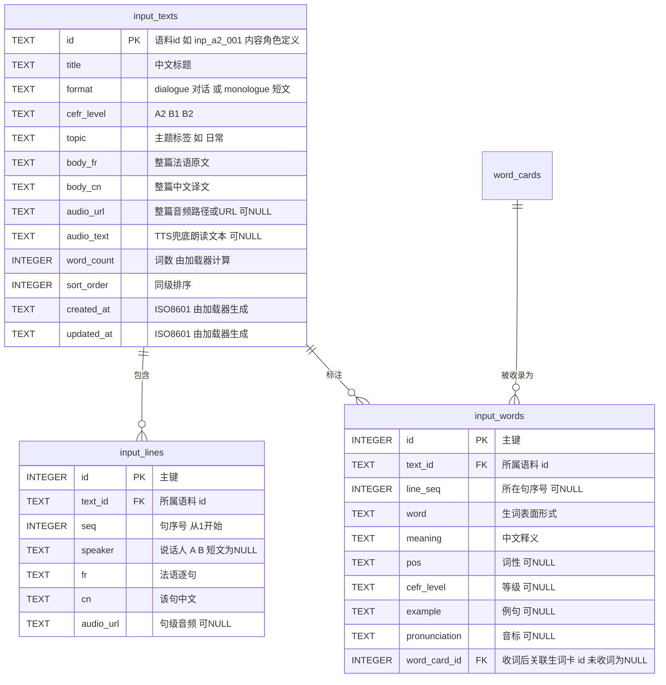

# 呀呀法语（YaYa French）架构契约 v2.0

> 本文是**后端、前端、内容、测试**四位同事在阶段二的**共同且唯一输入**。所有字段名、端点路径、数据格式必须逐字实现，不得自行改名、改值、增删字段。
> v2 是对 v1（`docs/ARCHITECTURE.md`）的**增量扩展**：v1 已定义的 7 个业务端点、3 个 ASR/TTS 代理、统一响应包裹、SM-2 接口、5 张表结构**全部保持不变**。
> 日期：2026-11-17　读者：后端工程师、前端工程师、内容工程师、测试工程师。

---

## 0. 本文定位与阅读顺序

| 你是 | 必读章节 |
|------|----------|
| 后端 | 全文，尤其 §2 §3 §4 §5 §9 |
| 前端 | §1 §5 §6 §7 §8（重点是新增 5 个端点与前端兼容项） |
| 内容 | §4.3 §5.4 §5.5 §7 §9（语料 JSON schema 与存放位置） |
| 测试 | §1 §3.5 §5 §7 §8 |

约定沿用 v1 §0：`snake_case` 命名、ISO8601 时间、空值用 `null`、布尔库内 INTEGER 0/1 出参转 bool、角色仅 `user`/`assistant`、rating 仅整数 1/2/3/4、**所有 API 返回 `{code,data,message}`**。本文不再重复这些全局约定。

---

## 1. 与 v1 的关系（沿用 / 新增 / 改造 / 不破坏清单）

### 1.1 沿用（一字不改）

- 统一响应包裹：成功 `{code:0, data:..., message:"ok"}`；失败 `{code:<非0>, data:null, message:"..."}`。
- 错误码集合：仅 `0 / 40001 / 40401 / 50001`，**v2 不新增错误码**。
- CORS 参数、`GET /api/health` 响应结构与取值（含 `version:"1.0.0"`，**保持原值不变，零回归**）。
- SM-2 `srs.py` 的 `schedule(rating, state)` 签名与公式、`ReviewResult{next_due,interval_days}`。
- 现有 5 张表（users / scenes / dialogue_turns / word_cards / review_logs）的**结构与字段**一字不改。
- 现有 7 个业务端点的**路径、入参、出参 data 结构**：`GET /api/scenes`、`GET /api/scenes/{scene_id}`、`POST /api/chat`、`GET /api/cards`、`POST /api/cards/{id}/review`、`GET /api/profile`、`GET /api/health`。
- 现有 3 个代理：`GET /api/asr/status`、`POST /api/asr/transcribe`、`GET /api/tts`（含浏览器音频解锁机制）。
- 降级哲学：**任何外部能力失败都不得向前端抛 500（除入参非法）**。

### 1.2 新增

- 智谱 GLM 作为 LLM 主供应商（`ai.py` 内部改造，对外接口不变）。
- 3 张输入流数据表：`input_texts` / `input_lines` / `input_words`（见 §4）。
- 5 个输入流 API 端点（见 §5.1）：`/api/input/*`。
- 输入语料 JSON 文件与加载器（见 §5.4 §5.5 §9）。

### 1.3 改造（仅内部实现，对外契约不变）

| 改造点 | v1 | v2 | 对外影响 |
|--------|----|----|----------|
| `ai.py` 的 LLM 分支 | OpenAI 兼容，`LLM_*` 环境变量 | 智谱 GLM 优先，`GLM_*` 为主、`LLM_*` 为兼容别名（见 §3.1） | 无。`recast()` 签名与 `ChatResult` 的 4 字段 JSON 不变 |
| LLM 返回格式容错 | 非 JSON 时整段当 `ai_text` | **严格模式**：非合法 JSON 或 `ai_text` 非非空字符串 → 降级本地规则（见 §3.4 §3.5） | 无。仅在调用失败时结果来自本地规则，前端无感 |
| 收词来源 | 仅本地场景词表匹配 `ai_text` | 本地场景词表 **+** LLM 建议的 `new_words` 合并去重（见 §3.8） | 无。`new_words` 出参仍是 `WordCard[]` |
| 话术池 | 场景 `reply_pool` 轮转 | 不变 | 无 |

### 1.4 硬性不破坏项（测试据此回归）

1. `POST /api/chat` 请求体仍是 `{scene_id, user_text, history}`，响应 `data` 仍是且仅是 `{ai_text, recast_of, explanation, new_words}`。
2. `new_words` 元素仍是完整 `WordCard`（含 id/created_at），不是词字符串。
3. `GET /api/health` 的 `version` 仍是 `"1.0.0"`。
4. 前端离线 fallback（`FALLBACK_*`、`fallbackChat`、`RECAST_RULES`）逻辑不受影响。
5. `backend/requirements.txt` 仍只有 `fastapi`、`uvicorn` 两行。

---

## 2. 技术栈增量与取舍

| 层次 | v2 增量 | 取舍理由 |
|------|---------|----------|
| LLM HTTP 调用 | Python 标准库 `urllib.request` + `json`，**不引入 `requests`/`httpx`/`openai`/`zhipuai` 等任何新包** | v1 已用 `urllib` 成功实现 ASR/TTS 代理，零新依赖；主后端 `requirements.txt` 锁定两行不动；智谱 OpenAI 兼容端点用裸 `urllib` 即可覆盖 |
| 配置文件 | 纯环境变量 + 可选的 `backend/.env.example`（不引 `python-dotenv`） | 保持零依赖；环境变量由启动 shell 导出（见 §9.2） |
| 输入流存储 | SQLite（标准库 `sqlite3`），新增 3 张表于**同一个** `backend/data/yaya.db` | 与 v1 同库同连接方式，无新文件、无迁移工具；收词可直接复用 `word_cards` 与 `db.create_card()` |
| 语料文件 | JSON 文件放 `french-learner/data/input/`，启动时由加载器同步入 SQLite | 内容角色只产出数据文件，不碰数据库；加载器幂等，支持热更新语料 |

**依赖锁死**：`backend/requirements.txt` 保持且仅保持两行 `fastapi`、`uvicorn`。任何新增依赖须先与架构师确认。

---

## 3. LLM（智谱 GLM）适配层设计

所有改动集中在 `backend/ai.py`。`recast(scene_id, user_text, history) -> ChatResult` 是唯一对外入口，签名与 v1 完全一致。

### 3.1 环境变量与优先级

对每个参数（key / base_url / model）**独立**按以下顺序取第一个非空值（Python 中 `or` 的空串语义正好实现"非空"判断）：

```python
GLM_API_KEY  = os.environ.get("GLM_API_KEY",  "").strip() or os.environ.get("LLM_API_KEY",  "").strip()
GLM_BASE_URL = os.environ.get("GLM_BASE_URL", "").strip() or os.environ.get("LLM_BASE_URL", "").strip() or "https://open.bigmodel.cn/api/paas/v4"
GLM_MODEL    = os.environ.get("GLM_MODEL",    "").strip() or os.environ.get("LLM_MODEL",    "").strip() or "glm-4-flash"
```

| 优先级 | KEY | BASE_URL | MODEL | 说明 |
|:---:|-----|----------|-------|------|
| 1（最高） | `GLM_API_KEY` | `GLM_BASE_URL` | `GLM_MODEL` | 阶段二主变量 |
| 2（兼容别名 / 后备） | `LLM_API_KEY` | `LLM_BASE_URL` | `LLM_MODEL` | v1 旧配置继续可用；仅设了这些且未设 GLM_* 时生效 |
| 3（默认） | 空（→ 降级） | `https://open.bigmodel.cn/api/paas/v4` | `glm-4-flash` | 三者都没设时 |

**关键判定**：
- `GLM_API_KEY` 与 `LLM_API_KEY` **均为空** → 判定为"无 key"，**不发任何网络请求**，直接走本地规则。
- 若使用**非智谱**的 OpenAI 兼容供应商：必须**同时**设置 `LLM_API_KEY` / `LLM_BASE_URL` / `LLM_MODEL` 三者（缺 base_url/model 会落到 GLM 默认值导致端点与供应商不匹配）。此点须在 `.env.example` 注释说明。

### 3.2 端点与默认值

| 项 | 值 |
|----|----|
| 完整请求 URL | `{GLM_BASE_URL}/chat/completions`（构造时 `.rstrip("/")` 去掉尾斜杠） |
| 默认完整 URL | `https://open.bigmodel.cn/api/paas/v4/chat/completions` |
| 默认模型 | `glm-4-flash` |
| 鉴权头 | `Authorization: Bearer {GLM_API_KEY}` |
| 请求方法 | POST |

### 3.3 请求体 / 响应体样例

请求体（POST 到完整 URL）：

```json
{
  "model": "glm-4-flash",
  "messages": [
    { "role": "system", "content": "<§3.7 的 SYSTEM_PROMPT 全文>" },
    { "role": "user", "content": "{\"scene\":{\"id\":\"cafe\",\"title\":\"在咖啡馆点单\",\"cefr_level\":\"A2\"},\"learner\":{\"cefr_level\":\"A2\",\"target_level\":\"B2\"},\"recent_history\":[{\"role\":\"user\",\"fr\":\"Bonjour\"},{\"role\":\"assistant\",\"fr\":\"Bonjour ! Que voulez-vous ?\"}],\"user_text\":\"Je veux un thé.\"}" }
  ],
  "temperature": 0.7,
  "max_tokens": 512
}
```

- `recent_history`：来自入参 `history`（DialogueTurn[]），**后端映射为 `[{"role","fr"}]` 后再交给 LLM**，只取最后 10 轮，以压缩 token（前端仍传完整 DialogueTurn[]，契约不变）。
- `learner.cefr_level` / `target_level`：取自 `db.get_profile()`（`DEFAULT_USER_ID=1`）。

智谱 OpenAI 兼容成功响应体（后端只关心 `choices[0].message.content`）：

```json
{
  "id": "20261117193012345678",
  "object": "chat.completion",
  "created": 1763407812,
  "model": "glm-4-flash",
  "choices": [
    {
      "index": 0,
      "message": {
        "role": "assistant",
        "content": "{\"ai_text\":\"Bien sûr ! Je vous apporte un thé tout de suite. Vous le voulez chaud ?\",\"recast_of\":\"Je veux un thé.\",\"explanation\":\"想礼貌点单，法国人更常说 Je voudrais，不过你这样说也完全能懂～\",\"new_words\":[{\"word\":\"tout de suite\",\"meaning\":\"马上\",\"pos\":\"loc.\",\"cefr_level\":\"A2\"}]}"
      },
      "finish_reason": "stop"
    }
  ],
  "usage": { "prompt_tokens": 320, "completion_tokens": 98, "total_tokens": 418 }
}
```

> 注意：`content` 是一个**JSON 字符串**（其中的引号被转义），后端需先取字符串再 `json.loads`。

### 3.4 JSON 解析与容错（严格模式）

解析函数 `_parse_llm_content(content: str) -> ChatResult` 步骤：

1. `text = content.strip()`。
2. 若以 ``` 开头，用正则去掉 markdown 围栏：`re.sub(r"^```(?:json)?\s*|\s*```$", "", text).strip()`。
3. `obj = json.loads(text)`；抛 `ValueError`/`TypeError` → **降级**（不再像 v1 那样把整段当 `ai_text`）。
4. `obj` 必须为 `dict` 且 `obj["ai_text"]` 为非空字符串（`strip()` 后非空）→ 判定成功。
5. 成功时字段补全规则：
   - `ai_text`：取 `obj["ai_text"].strip()`。
   - `recast_of`：`isinstance(str) and strip()` 才保留，否则 `None`（含缺失、`null`、空串）。
   - `explanation`：同上规则，否则 `None`。
   - `new_words`：仅当为 `list` 时保留，且**逐元素过滤**——只保留含非空字符串 `word` 的 `dict` 元素；其余丢弃；最终不是 list 或缺字段 → `[]`。
6. 任一不满足 → 抛 `ValueError("LLM 返回格式异常")` → 由 `recast()` 统一降级。

### 3.5 降级判定条件表（务必逐条覆盖）

| # | 条件 | 是否重试 | 动作 |
|---|------|:---:|------|
| 1 | `GLM_API_KEY` 与 `LLM_API_KEY` 均为空 | 否 | **无 key**：直接本地规则，零网络请求 |
| 2 | DNS 失败 / 连接拒绝 / 网络不可达（`URLError` 非 HTTP） | 是（1 次） | 重试仍失败 → 本地规则 |
| 3 | 单次请求超时（`socket.timeout` / `TimeoutError`，超过 `GLM_TIMEOUT_SECONDS`） | 是（1 次） | 重试仍失败 → 本地规则 |
| 4 | HTTP 429（限流）或 5xx | 是（1 次） | 重试仍失败 → 本地规则 |
| 5 | HTTP 401 / 403（key 无效）及其他 4xx | 否 | 立即本地规则 + 日志告警 |
| 6 | 响应体非合法 JSON / `choices` 为空 / `message.content` 缺失 | 否 | 本地规则（格式异常） |
| 7 | `content` 非合法 JSON 对象 / `ai_text` 非字符串或空 | 否 | 本地规则（格式异常） |
| 8 | 解析成功但 `recast_of`/`explanation` 缺失或 `new_words` 非法 | — | **不算失败**：按 §3.4 步骤 5 补全后照常返回 |
| 9 | `urllib` 抛出其他任意异常 | 否 | 本地规则（`recast()` 的兜底 `except Exception`） |

> 任一降级都写 `logger.warning("LLM 重述失败，回退本地规则：%s", exc)`。**除入参非法外，永不向前端抛 500**。

### 3.6 超时与重试策略

| 参数 | 值 | 说明 |
|------|----|------|
| `GLM_TIMEOUT_SECONDS` | 8（秒） | `urlopen(req, timeout=8)` 单次超时 |
| 最大尝试次数 | 2 | 首次 + 最多 1 次重试（仅针对 §3.5 中 #2/#3/#4） |
| 重试间隔 | 0.3 秒 | `time.sleep(0.3)`，仅标准库 |
| 最坏耗时 | ≈ 16.3 秒 | 超时后仍降级返回 200，不抛 500 |
| 可重试异常 | `URLError`（非 HTTPError）、`socket.timeout`、`TimeoutError`、`HTTPError` 且 code ∈ {429} ∪ [500,600) | 用 `isinstance` 判断 |
| 不可重试 | `HTTPError` 4xx（除 429）、所有格式异常 | 立即降级 |

> 注：`GLM_TIMEOUT_SECONDS`（=8）与重试间隔（=0.3 秒）是 `ai.py` 内的**模块级常量**，固定值，**不是环境变量**，不写入 `.env.example`（§9.1）。后端如需调整直接改常量即可。

实现建议：`recast_llm()` 内部用 `for attempt in range(2)` 包住网络请求 + 解析，捕获可重试异常时 `if attempt == 0: time.sleep(0.3); continue`，否则 `raise`；最终由 `recast()` 的 `except Exception` 兜底到本地规则。

### 3.7 Prompt 模板（完整可复制）

**SYSTEM_PROMPT**（逐字使用，作为 `messages[0].content`）：

```
你是「呀呀（YaYa）」，一位温柔、耐心的法语口语陪练。你的说话对象是一位正在学习法语的中文母语者。

核心任务：
1. 顺着用户上一句话自然接话，让对话像真人聊天一样继续下去。回应要简短、口语化，可以是一句陈述或一句追问。
2. 如果用户说的法语有语法、用词或搭配错误，绝对不要说「你错了」，不要打红叉，不要罗列语法规则，不要给出冷冰冰的批改。
   正确做法是「自然重述（recast）」：先用一句自然的回应接住对方的意思，再把正确的说法自然地嵌进你的法语回应里，让用户在理解上下文时顺便吸收正确形式。
   例如用户说「Je veux un thé.」，你可以回应「Bien sûr ! Je vous apporte un thé tout de suite. Vous le voulez chaud ?」——在自然服务对话里示范了礼貌表达，而不是纠错。
3. 法语输出要控制在对方水平可理解的范围内：多用常用词、句子宜短。

输出要求（最重要，必须严格遵守）：
- 只输出一个 JSON 对象，不要输出任何解释文字，不要使用 markdown 代码围栏。
- JSON 必须且只能包含以下四个键：
  {
    "ai_text": "string，你用法语说的回应；若发生纠错，正确说法要自然嵌在这里",
    "recast_of": "string 或 null，被纠错的『用户原句』；未纠错时必须为 null",
    "explanation": "string 或 null，面向中文用户的温和一句讲解；未纠错时必须为 null",
    "new_words": "array，你在回应中用到的、用户可能不认识的法语词，0~5 个"
  }
- new_words 数组每个元素形如：
  {"word": "法语词或短语", "meaning": "中文释义", "pos": "词性缩写", "cefr_level": "A2"}
  其中 pos 可用 n.m./n.f./adj./adv./loc./v./cond. 等；cefr_level 取 A1/A2/B1/B2/C1/C2，不确定时为 null。
- 如果用户的表达没有错误，recast_of 与 explanation 都必须为 null，不要为了纠错而纠错。
- explanation 要温和、简短（一句话），例如「想礼貌点单，法国人更常说 voudrais，不过你这样说也完全能懂」。
- 确保输出是合法 JSON：字符串内的引号要正确转义。
```

**USER content**（`messages[1].content`）是 §3.3 所示的 context JSON 字符串，由 `json.dumps(context, ensure_ascii=False)` 生成，`context` 结构：

```python
{
  "scene": {"id": scene_id, "title": <seed.title>, "cefr_level": <seed.cefr_level>},
  "learner": {"cefr_level": <profile.cefr_level>, "target_level": <profile.target_level>},
  "recent_history": [{"role": t["role"], "fr": t["fr"]} for t in history[-10:]],
  "user_text": user_text
}
```

### 3.8 对 `/api/chat` 契约的影响（内部机制，前端无感）

`ChatResult` 内部增加**不进 JSON** 的字段 `llm_new_words`，`to_dict()` 仍只输出 v1 的 4 字段：

```python
@dataclass
class ChatResult:
    ai_text: str
    recast_of: Optional[str] = None
    explanation: Optional[str] = None
    new_words: list = field(default_factory=list)      # 最终 WordCard[]，进 to_dict
    llm_new_words: list = field(default_factory=list)  # 内部：LLM 建议候选词，不进 to_dict

    def to_dict(self) -> dict:
        return {
            "ai_text": self.ai_text,
            "recast_of": self.recast_of,
            "explanation": self.explanation,
            "new_words": self.new_words,
        }
```

收词逻辑 `_extract_new_words(scene_id, ai_text, llm_new_words)`：

1. **来源 A（LLM 建议）**：遍历 `llm_new_words`，仅当元素的 `word` 为非空字符串、`meaning` 为非空字符串，且 `word.lower() in ai_text.lower()`（大小写不敏感子串命中）时，作为建卡候选，字段取 `word/meaning/pos/cefr_level`（`pos`/`cefr_level` 可 null）。
2. **来源 B（本地场景词表，v1 逻辑）**：`seed.get_scene_seed(scene_id)["vocab"] + ["extra_vocab"]`，对 `ai_text` 做大小写不敏感子串命中。
3. 合并 A、B，统一按 `word` 去重；对每个候选调用 `db.create_card(user_id=1, ..., source_scene_id=scene_id)`（**内部按 `(user_id, word)` 查重并同步插入初始 `review_logs`**）。`create_card` 返回的即 `WordCard`，组装进 `result.new_words`。
4. 降级时 `llm_new_words=[]`，逻辑退化为 v1 的纯本地匹配。
5. `is_correction` / 落库 / XP 逻辑完全沿用 v1（见 `app.py::chat`）。

---

## 4. 数据模型增量

### 4.1 ER 图（新表）



### 4.2 新表字段定义（与 §5 的 Schema 逐字一致）

**`input_texts`**（主键 `id`，唯一）

| 字段 | 类型 | 可空 | 说明 |
|------|------|:---:|------|
| id | TEXT | 否 | 语料 id，内容角色定义，全库唯一，建议格式 `inp_<level>_<序号>` |
| title | TEXT | 否 | 中文标题 |
| format | TEXT | 否 | `dialogue`（对话）或 `monologue`（短文） |
| cefr_level | TEXT | 否 | `A2` / `B1` / `B2` |
| topic | TEXT | 否 | 主题标签，如 `日常`、`出行` |
| body_fr | TEXT | 否 | 整篇法语原文（对话用换行分隔） |
| body_cn | TEXT | 否 | 整篇中文译文 |
| audio_url | TEXT | 是 | 整篇音频路径或 URL；为 null 时前端用浏览器 TTS 兜底 |
| audio_text | TEXT | 是 | TTS 兜底朗读文本；为 null 时用 `body_fr` |
| word_count | INTEGER | 否 | 词数，由加载器计算（按空白/标点切词） |
| sort_order | INTEGER | 否 | 同级排序，默认 0 |
| created_at | TEXT | 否 | ISO8601，由加载器生成 |
| updated_at | TEXT | 否 | ISO8601，由加载器生成 |

**`input_lines`**（唯一约束 `(text_id, seq)`）

| 字段 | 类型 | 可空 | 说明 |
|------|------|:---:|------|
| id | INTEGER | 否 | 自增主键 |
| text_id | TEXT | 否 | FK → input_texts.id |
| seq | INTEGER | 否 | 句序号，从 1 开始 |
| speaker | TEXT | 是 | 对话为 `A`/`B`；短文为 null |
| fr | TEXT | 否 | 法语逐句 |
| cn | TEXT | 否 | 该句中文 |
| audio_url | TEXT | 是 | 句级音频，可 null |

**`input_words`**（唯一约束 `(text_id, word)`）

| 字段 | 类型 | 可空 | 说明 |
|------|------|:---:|------|
| id | INTEGER | 否 | 自增主键 |
| text_id | TEXT | 否 | FK → input_texts.id |
| line_seq | INTEGER | 是 | 所在句序号，对应 input_lines.seq；可 null |
| word | TEXT | 否 | 生词表面形式（法语） |
| meaning | TEXT | 否 | 中文释义 |
| pos | TEXT | 是 | 词性 |
| cefr_level | TEXT | 是 | 等级 |
| example | TEXT | 是 | 例句 |
| pronunciation | TEXT | 是 | 音标 |
| word_card_id | INTEGER | 是 | FK → word_cards.id；收词入库后回填，未收词为 null |

**DDL 迁移**：在 `db.py` 的 `DDL` 字符串中追加上述三表 `CREATE TABLE IF NOT EXISTS` 与索引：
```sql
CREATE INDEX IF NOT EXISTS idx_input_texts_level ON input_texts (cefr_level, sort_order);
CREATE INDEX IF NOT EXISTS idx_input_lines_text ON input_lines (text_id, seq);
CREATE INDEX IF NOT EXISTS idx_input_words_text ON input_words (text_id);
```
> 现有 5 张表 DDL 一字不改；新表通过 `init_db()` 的 `CREATE TABLE IF NOT EXISTS` 自动创建，老库可直接升级。

### 4.3 与 `word_cards` 的收词关系

- **不改 `word_cards` 结构**。输入流收词时调用现有 `db.create_card(user_id=1, word, meaning, pos, example, pronunciation, cefr_level, source_scene_id=None)`。
  - `source_scene_id` 存 `null`（合法，v1 约定可空）——**不要**把输入语料 id 塞进这个字段，避免污染场景语义。
  - 来源语义保存在 `input_words.word_card_id` 关联中。
- `db.create_card` 内部已按 `(user_id, word)` 查重并同步插入初始 `review_logs`（`repetitions=0, ease_factor=2.5, interval_days=0, next_due=now`），**收词复用它即可，天然幂等**。
- 收词后把返回的 `card["id"]` 回填到 `input_words.word_card_id`（重复收词时 id 不变）。
- 掌握度判定统一用 `review_logs.repetitions >= 5`（与 v1 `get_profile().stats.mastered_count` 口径一致），供 §6 自适应使用。

---

## 5. 输入流 API 契约（最重要）

Base URL 与 v1 相同：`http://localhost:8000`，前缀 `/api`，统一 `{code,data,message}` 包裹。所有 GET 的 Query 参数名逐字如下。

### 5.1 端点总览

**v2 新增 5 个端点**：

| # | 方法 | 路径 | 请求体 / Query | 成功响应 `data` | 错误码 |
|---|------|------|----------------|------------------|--------|
| 11 | GET | `/api/input/levels` | 无 | `LevelInfo[]` | 50001(500) |
| 12 | GET | `/api/input/texts` | Query: `level?`, `limit?`, `offset?` | `TextListResult` | 40001(400), 50001(500) |
| 13 | GET | `/api/input/texts/{id}` | 路径参数 `id:string` | `InputTextDetail` | 40401(404), 50001(500) |
| 14 | POST | `/api/input/texts/{id}/collect` | 路径 `id:string`；Body（可选）`{words?: string[]}` | `CollectResult` | 40001(400), 40401(404), 50001(500) |
| 15 | GET | `/api/input/recommend` | Query: `exclude_ids?`, `limit?` | `RecommendResult` | 40001(400), 50001(500) |

**v1 端点状态**：§1.1 列出的 7 个业务端点 + 3 个代理端点**全部保留、路径与契约不变**；其中 `POST /api/chat` 仅内部实现改造（§3）。

### 5.2 新增 Schema 定义（唯一字段定义，前后端对照）

**LevelInfo**（`/api/input/levels` 元素）

| 字段 | 类型 | 说明 |
|------|------|------|
| level | string | 等级 `A2`/`B1`/`B2` |
| count | int | 该等级下的语料篇数 |

**InputTextSummary**（列表元素，轻量）

| 字段 | 类型 | 说明 |
|------|------|------|
| id | string | 语料 id |
| title | string | 中文标题 |
| format | string | `dialogue` / `monologue` |
| cefr_level | string | `A2`/`B1`/`B2` |
| topic | string | 主题标签 |
| word_count | int | 词数 |
| audio_url | string\|null | 整篇音频 |
| sort_order | int | 排序 |

**InputLine**（逐句，详情与列表都不含，仅详情返回）

| 字段 | 类型 | 说明 |
|------|------|------|
| seq | int | 句序号 |
| speaker | string\|null | `A`/`B`；短文为 null |
| fr | string | 法语逐句 |
| cn | string | 该句中文 |
| audio_url | string\|null | 句级音频 |

**InputWord**（生词标注）

| 字段 | 类型 | 说明 |
|------|------|------|
| word | string | 生词表面形式 |
| meaning | string | 中文释义 |
| pos | string\|null | 词性 |
| cefr_level | string\|null | 等级 |
| example | string\|null | 例句 |
| pronunciation | string\|null | 音标 |
| line_seq | int\|null | 所在句序号 |
| word_card_id | int\|null | 收词后关联的卡片 id；未收词为 null |

**InputTextDetail**（`/api/input/texts/{id}` 的 data）

| 字段 | 类型 | 说明 |
|------|------|------|
| id / title / format / cefr_level / topic / word_count / audio_url / sort_order | 同 InputTextSummary | 主表字段 |
| body_fr | string | 整篇法语原文 |
| body_cn | string | 整篇中文译文 |
| audio_text | string\|null | TTS 兜底朗读文本 |
| lines | InputLine[] | 逐句数组，按 `seq` 升序 |
| words | InputWord[] | 生词数组，按 `line_seq`（null 排后）再 `word` 升序 |
| created_at | string | ISO8601 |
| updated_at | string | ISO8601 |

**TextListResult**（`/api/input/texts` 的 data）

| 字段 | 类型 | 说明 |
|------|------|------|
| items | InputTextSummary[] | 当前页列表 |
| total | int | 过滤后的总篇数 |
| level | string\|null | 实际过滤等级，未传为 null |

**CollectResult**（`/api/input/texts/{id}/collect` 的 data）

| 字段 | 类型 | 说明 |
|------|------|------|
| text_id | string | 语料 id |
| collected | WordCard[] | 本次成功关联到卡的生词（含新建与已存在） |
| already_existed | string[] | 其中原本已存在（未重复建卡）的 word |
| skipped | string[] | 因 word/meaning 缺失未建卡的 word |

**RecommendResult**（`/api/input/recommend` 的 data）

| 字段 | 类型 | 说明 |
|------|------|------|
| text | InputTextDetail\|null | 推荐的一篇；无候选时为 null |
| target_level | string | 本次计算的目标等级（i+1） |
| reason | string | `level_and_coverage` / `level_only_fallback` / `no_candidate`（见 §6） |

> `WordCard` 结构沿用 v1 §4.4，**不重新定义**。

### 5.3 逐端点详解

#### 11) GET `/api/input/levels` — 可用等级列表
- 请求：无。
- 响应 `data`：`LevelInfo[]`，按 CEFR 顺序 `A2 < B1 < B2`，只返回**有语料**的等级（count>0）。
- 示例：
```json
{ "code":0, "data":[{"level":"A2","count":4},{"level":"B1","count":3},{"level":"B2","count":2}], "message":"ok" }
```

#### 12) GET `/api/input/texts` — 文本列表
- Query：
  - `level`（可选）：`A2`/`B1`/`B2`；非法值（非三者之一）→ 40001。
  - `limit`（可选）：整数，默认 20，范围 1~50；非法 → 40001。
  - `offset`（可选）：整数 ≥ 0，默认 0；非法 → 40001。
- 响应 `data`：`TextListResult`。按 `cefr_level` 的 CEFR 顺序、同级 `sort_order` 升序，再 `offset/limit` 分页。
- 示例：`GET /api/input/texts?level=A2&limit=10&offset=0`

#### 13) GET `/api/input/texts/{id}` — 文本详情
- 路径参数 `id`：string。
- 响应 `data`：`InputTextDetail`（含 `lines`、`words`）。
- 错误：`id` 不存在 → 40401 / HTTP 404。

#### 14) POST `/api/input/texts/{id}/collect` — 收词入库
- 路径参数 `id`：string。
- 请求体（可选）：`{ "words": ["la gare", "tout de suite"] }`
  - `words`：`string[]`，元素需 trim 后非空；省略、null 或空数组 → **收该文本全部生词**。
  - 非数组或含非字符串元素 → 40001。
  - 只收 `words` 中**存在于该文本 `input_words.word`** 的词；传入不存在的词忽略（不报错、不建卡）。
- 响应 `data`：`CollectResult`。
- 行为：对每个目标生词，取 `input_words.word/meaning/pos/cefr_level/example/pronunciation`，调用 `db.create_card(..., source_scene_id=None)`；回填 `word_card_id`。幂等：重复调用不重复建卡、不重复插 `review_logs`。
- 错误：`id` 不存在 → 40401；`words` 格式非法 → 40001。

#### 15) GET `/api/input/recommend` — 难度自适应推荐
- Query：
  - `exclude_ids`（可选）：逗号分隔的语料 id，如 `inp_a2_001,inp_a2_002`；用于排除已读。空串等同未传。
  - `limit`（可选）：整数，默认 1，范围 1~10；非法 → 40001。
- 响应 `data`：`RecommendResult`。`text` 为完整的 `InputTextDetail`（含 lines/words），前端拿到即可直接渲染。
- 规则：见 §6。
- 无候选时：`{text:null, target_level:<计算值>, reason:"no_candidate"}`，`code=0`。

### 5.4 输入语料 JSON Schema（内容角色照此产出）

文件：`french-learner/data/input/texts.json`，UTF-8，`ensure_ascii=false` 风格（中文/法语直接写字符）。

```json
{
  "version": 1,
  "texts": [
    {
      "id": "inp_a2_001",
      "title": "在面包店",
      "format": "dialogue",
      "cefr_level": "A2",
      "topic": "日常",
      "body_fr": "Bonjour ! Je voudrais une baguette.\nBien sûr ! Vous en voulez une autre ?",
      "body_cn": "你好！我想要一根法棍。\n当然！您还要再来一根吗？",
      "audio_url": "/data/input/audio/inp_a2_001.mp3",
      "sort_order": 1,
      "lines": [
        { "seq": 1, "speaker": "A", "fr": "Bonjour ! Je voudrais une baguette.", "cn": "你好！我想要一根法棍。", "audio_url": null },
        { "seq": 2, "speaker": "B", "fr": "Bien sûr ! Vous en voulez une autre ?", "cn": "当然！您还要再来一根吗？", "audio_url": null }
      ],
      "words": [
        { "word": "une baguette", "meaning": "一根法棍", "pos": "n.f.", "cefr_level": "A2", "example": "Je voudrais une baguette.", "pronunciation": "yn ba.ɡɛt", "line_seq": 1 },
        { "word": "bien sûr", "meaning": "当然", "pos": "loc.", "cefr_level": "A1", "example": "Bien sûr !", "pronunciation": "bjɛ̃ syʁ", "line_seq": 2 }
      ]
    }
  ]
}
```

**字段约束（内容角色必读）**

| 路径 | 必填 | 类型/取值 | 说明 |
|------|:---:|-----------|------|
| `version` | 是 | int，当前为 1 | 文件版本号 |
| `texts` | 是 | array | 语料数组 |
| `texts[].id` | 是 | string，全文件唯一 | 建议 `inp_<level>_<三位序号>`，如 `inp_a2_001` |
| `texts[].title` | 是 | string | 中文标题 |
| `texts[].format` | 是 | `dialogue` / `monologue` | 对话 / 短文 |
| `texts[].cefr_level` | 是 | `A2` / `B1` / `B2` | 严格三选一，其他值整条跳过 |
| `texts[].topic` | 是 | string | 主题标签 |
| `texts[].body_fr` | 是 | string | 整篇法语原文 |
| `texts[].body_cn` | 是 | string | 整篇中文译文 |
| `texts[].audio_url` | 否 | string\|null | 音频文件路径或 URL；无音频填 null，前端用 TTS 兜底 |
| `texts[].audio_text` | 否 | string\|null | TTS 兜底朗读文本；省略时加载器用 `body_fr` 填充，内容角色通常不用写 |
| `texts[].sort_order` | 否 | int，默认 0 | 同级排序 |
| `texts[].lines` | 是 | array，长度≥1 | 逐句数组 |
| `texts[].lines[].seq` | 是 | int，从 1 递增 | 同一 text 内唯一 |
| `texts[].lines[].speaker` | 条件 | `A`/`B`（dialogue）；null（monologue） | |
| `texts[].lines[].fr` | 是 | string | 法语逐句 |
| `texts[].lines[].cn` | 是 | string | 该句中文 |
| `texts[].lines[].audio_url` | 否 | string\|null | 句级音频 |
| `texts[].words` | 否 | array | 生词标注，可空数组 |
| `texts[].words[].word` | 是 | string | 生词表面形式；缺失跳过该词 |
| `texts[].words[].meaning` | 是 | string | 中文释义；缺失跳过该词 |
| `texts[].words[].pos` | 否 | string\|null | 词性 |
| `texts[].words[].cefr_level` | 否 | `A1`..`C2`\|null | |
| `texts[].words[].example` | 否 | string\|null | 例句 |
| `texts[].words[].pronunciation` | 否 | string\|null | 音标 |
| `texts[].words[].line_seq` | 否 | int\|null | 须指向存在的 `lines[].seq`，否则置 null |

> `word_count`、`created_at`、`updated_at` **由加载器生成**；`audio_text` 省略时由加载器用 `body_fr` 填充（因此内容角色通常不必写）。内容角色不要写 `word_count/created_at/updated_at`。

### 5.5 语料加载方式

- 新增模块 `backend/seed_input.py`，暴露 `load_input_corpus() -> None`（幂等，可重复调用）。
- 路径常量：`INPUT_DIR = Path(__file__).resolve().parent.parent / "data" / "input"`（即 `french-learner/data/input/`），语料文件 `INPUT_DIR / "texts.json"`。
- 启动流程更新（`app.py` 尾部）：
  ```python
  db.init_db()
  if db.is_empty():
      seed.seed_if_empty()
  seed_input.load_input_corpus()   # 新增：每次启动同步语料（幂等）
  ```
- 加载器行为：
  1. 文件不存在 → 记录 info 日志并跳过（不阻断启动，输入流返回空列表）。
  2. 逐条校验 §5.4 约束；**单条非法只跳过该条 + warning 日志**，不影响其他条与服务启动（降级哲学）。
  3. 合法条：`input_texts` 用 `INSERT ... ON CONFLICT(id) DO UPDATE` 写入（更新时刷新 `updated_at`）；对应 `input_lines`/`input_words` 先按 `text_id` 删除旧行再插入（保证语料改版同步）。
  4. `word_count` = 对 `body_fr` 按正则 `re.findall(r"[A-Za-zÀ-ÿ]+", body_fr)` 计数；`audio_text` 为空时用 `body_fr` 填充。
  5. `created_at` 首次生成，更新时保留；`updated_at` 每次刷新。
  6. 全程用 `db.get_conn()`，不新开连接方式。

---

## 6. 难度自适应（i+1）规则 —— 可执行

实现于 `app.py::recommend`（或抽到 `input_service.py`，由后端自定），输入 `profile = db.get_profile()`。

设 `CEFR_ORDER = ["A1","A2","B1","B2","C1","C2"]`。

**步骤 1 — 确定目标等级（i+1）**
```
L = profile["cefr_level"]                       # 当前等级，如 A2
idx = max(0, CEFR_ORDER.index(L))               # 非法值按 A1 处理
target_level = CEFR_ORDER[min(idx + 1, len(CEFR_ORDER) - 1)]   # i+1：A2→B1
```

**步骤 2 — 候选过滤**
- 取全部 `input_texts`；排除 `exclude_ids` 中的 id。
- 若传了 `limit`，最终返回前 `limit` 篇按分数排序的结果（默认 1）。

**步骤 3 — 计算每篇的可理解度 coverage**
```
words = 该篇 input_words 列表
total = len(words)
known = 统计满足以下条件的词数：
    存在 word_cards 行 (user_id=1, word=input_words.word)
    且该卡的 review_logs.repetitions >= 5          # 已掌握
coverage = known / total  if total > 0 else None   # 无生词标注 → None
```

**步骤 4 — 打分（每项独立累加）**

| 维度 | 条件 | 得分 |
|------|------|:---:|
| 等级匹配 | `text.cefr_level == target_level` | +3 |
| | `text.cefr_level == L` | +1 |
| | `text.cefr_level > target_level`（超出 i+1） | −2 |
| | `text.cefr_level < L`（低于当前） | −1 |
| 可理解度 | `coverage ∈ [0.7, 0.9]`（理想 i+1） | +3 |
| | `coverage ∈ [0.5, 0.7)`（偏难可接受） | +1 |
| | `coverage ∈ (0.9, 1.0]`（太简单，几乎无新词） | 0 |
| | `coverage < 0.5`（太难） | −2 |
| | `coverage is None`（无生词标注） | 0（走 level_only 分支） |

**步骤 5 — 选取与 reason**
- 有 `coverage is not None` 的候选：按总分降序、同分按 `sort_order` 升序、再 `id` 升序，取第一篇；`reason = "level_and_coverage"`。
- 仅当所有候选 `coverage is None`：按等级匹配维度打分选第一篇，`reason = "level_only_fallback"`。
- 无任何候选：`text = null`，`reason = "no_candidate"`。

**步骤 6 — 返回**
把选中的文本组装成 `InputTextDetail`（复用详情逻辑），返回 `RecommendResult{text, target_level, reason}`。

> 前端处理：`reason != "no_candidate"` 时用 `text` 渲染；`text.audio_url` 为空时用浏览器 TTS 读 `audio_text || body_fr`；用户点「收词」调端点 14。前端把已读 id 通过 `exclude_ids` 传回以 shuffling 换下一篇。

---

## 7. 字段一致性清单（四方逐字核对，勿改）

### 7.1 v2 新增环境变量

| 统一名称 | 出现位置 |
|----------|----------|
| `GLM_API_KEY` | §3.1、§9.1 `.env.example` |
| `GLM_BASE_URL` | §3.1、§3.2、§9.1 |
| `GLM_MODEL` | §3.1、§3.2、§9.1 |
| `LLM_API_KEY` / `LLM_BASE_URL` / `LLM_MODEL` | §3.1 兼容别名、§9.1 |

### 7.2 v2 新增数据表字段

| 表 | 字段（逐字） |
|----|--------------|
| `input_texts` | `id`, `title`, `format`, `cefr_level`, `topic`, `body_fr`, `body_cn`, `audio_url`, `audio_text`, `word_count`, `sort_order`, `created_at`, `updated_at` |
| `input_lines` | `id`, `text_id`, `seq`, `speaker`, `fr`, `cn`, `audio_url` |
| `input_words` | `id`, `text_id`, `line_seq`, `word`, `meaning`, `pos`, `cefr_level`, `example`, `pronunciation`, `word_card_id` |

### 7.3 v2 新增 API Schema 字段

| Schema | 字段 |
|--------|------|
| `LevelInfo` | `level`, `count` |
| `InputTextSummary` | `id`, `title`, `format`, `cefr_level`, `topic`, `word_count`, `audio_url`, `sort_order` |
| `InputLine` | `seq`, `speaker`, `fr`, `cn`, `audio_url` |
| `InputWord` | `word`, `meaning`, `pos`, `cefr_level`, `example`, `pronunciation`, `line_seq`, `word_card_id` |
| `InputTextDetail` | InputTextSummary 全部 + `body_fr`, `body_cn`, `audio_text`, `lines`, `words`, `created_at`, `updated_at` |
| `TextListResult` | `items`, `total`, `level` |
| `CollectResult` | `text_id`, `collected`, `already_existed`, `skipped` |
| `RecommendResult` | `text`, `target_level`, `reason` |

### 7.4 v2 新增 Query / Body / 内部字段

| 类别 | 名称 |
|------|------|
| Query（`texts`） | `level`, `limit`, `offset` |
| Query（`recommend`） | `exclude_ids`, `limit` |
| Body（collect） | `words` |
| `ChatResult` 内部（不进 JSON） | `llm_new_words` |
| `reason` 枚举 | `level_and_coverage` / `level_only_fallback` / `no_candidate` |
| `format` 枚举 | `dialogue` / `monologue` |

### 7.5 不变量（务必保持）

| 概念 | 全文统一名称 |
|------|--------------|
| 统一响应 | `{code,data,message}`，code=0/message="ok" |
| 错误码 | `40001` 参数错 / `40401` 不存在 / `50001` 内部 |
| ChatResult | `ai_text`, `recast_of`, `explanation`, `new_words`（仅这 4 个键进 JSON） |
| 生词卡 | `WordCard`（v1 结构，不增字段） |
| 角色 | `user` / `assistant` |
| 掌握度口径 | `review_logs.repetitions >= 5` |

---

## 8. 测试要点提示（测试角色必须覆盖的边界）

| # | 场景 | 预期 |
|---|------|------|
| 1 | 无 key（`GLM_API_KEY`/`LLM_API_KEY` 都空）调 `/api/chat` | 零网络请求，结果来自本地规则，保证 HTTP 200、`code=0` |
| 2 | key 无效（401）| 立即降级本地规则，不重试，不抛 500 |
| 3 | 超时 / 连接失败（mock `urlopen` 抛异常）| 重试 1 次后降级，`code=0` |
| 4 | LLM 返回非 JSON / `ai_text` 缺失或空 | 按 §3.4 严格模式降级本地规则 |
| 5 | LLM 返回合法 JSON 但缺 `recast_of`/`explanation`/`new_words` | 补全为 `null`/`null`/`[]`，仍算成功、`code=0` |
| 6 | `new_words` 含非法元素（非 dict / 无 word / 无 meaning / 不在 ai_text 中）| 被过滤，不建脏卡 |
| 7 | 收词去重：LLM 建议词与场景词表命中同一个词 | 只建一张卡；`new_words` 不重复 |
| 8 | `/api/input/levels` 无语料 | 返回 `[]`（不是报错） |
| 9 | `/api/input/texts?level=B2` 非法 level（如 `C3`）| `40001` / HTTP 400 |
| 10 | `/api/input/texts?limit=999` | `40001`（上限 50） |
| 11 | `/api/input/texts/{不存在id}` | `40401` / HTTP 404 |
| 12 | collect 幂等：同一 text 调两次 | 第二次 `collected` 中的卡 id 不变，`already_existed` 含全部词，`review_logs` 无重复插入 |
| 13 | collect 传 `words` 含文本不存在的词 | 忽略该词，不报错、不建卡 |
| 14 | collect `words` 传非数组 | `40001` |
| 15 | 语料 JSON 含非法条（如 `cefr_level="C3"`、缺 `lines`）| 加载器跳过该条 + 日志，服务正常启动，其余条可查 |
| 16 | 语料文件缺失 | 服务正常启动，输入流端点返回空列表/`no_candidate` |
| 17 | recommend i+1：`profile.cefr_level=A2` | `target_level="B1"`；优先选中 B1 且 coverage∈[0.7,0.9] 的篇，`reason="level_and_coverage"` |
| 18 | recommend `exclude_ids` 排除后无候选 | `text=null`, `reason="no_candidate"`, `code=0` |
| 19 | recommend `limit` 非法（0 / 11 / 非数字）| `40001` |
| 20 | **前端兼容回归**：7 个 v1 端点 + 3 个代理端点逐条请求 | 路径/入参/出参 data 与 v1 完全一致；`health.version="1.0.0"`；`ChatResult` 仍 4 字段 |
| 21 | 字段一致性：mermaid（§4.1）↔ DDL（§4.2）↔ Schema（§5.2）↔ 语料 schema（§5.4） | 三处字段名、类型逐字一致 |

---

## 9. 目录与配置

### 9.1 `backend/.env.example`（不含真实 key）

```dotenv
# ===== 智谱 GLM（阶段二主供应商，优先级最高）=====
GLM_API_KEY=
GLM_BASE_URL=https://open.bigmodel.cn/api/paas/v4
GLM_MODEL=glm-4-flash

# ===== 通用 OpenAI 兼容别名（可选后备）=====
# 说明：仅当对应 GLM_* 未设置时生效。
# 若改用非智谱供应商，必须同时设置下面三项（否则 base_url/model 会落到上面的 GLM 默认值）。
LLM_API_KEY=
LLM_BASE_URL=
LLM_MODEL=

# ===== 本地 ASR/TTS 服务（沿用 v1）=====
YAYA_ASR_URL=http://127.0.0.1:8010
```

> 不写真实 key；提交时此文件可入库，真实 `.env` 加入 `.gitignore`。

### 9.2 环境变量加载方式（不引新依赖）

Python 不自动读 `.env`。启动前由 shell 导出：

```bash
cd tools/french-learner/backend
set -a; . ./.env; set +a        # bash / Git Bash
uvicorn app:app --reload --host 0.0.0.0 --port 8000
```

Windows PowerShell 示例：
```powershell
$env:GLM_API_KEY = "你的key"
$env:GLM_BASE_URL = "https://open.bigmodel.cn/api/paas/v4"
$env:GLM_MODEL = "glm-4-flash"
uvicorn app:app --reload --host 0.0.0.0 --port 8000
```

### 9.3 目录结构（v2 增量部分）

```
french-learner/
├── data/                          # 新增：项目级语料目录（与 backend/data/yaya.db 分开）
│   └── input/
│       ├── texts.json             # 内容角色产出：全部语料（§5.4 schema）
│       └── audio/                 # 可选：mp3 音频，文件名与 audio_url 对应
│           └── inp_a2_001.mp3
├── backend/
│   ├── app.py                     # 增加 5 个 /api/input/* 路由 + 启动调用 load_input_corpus()
│   ├── ai.py                      # 改造：GLM 主 + 严格容错 + 降级 + LLM new_words 合并收词
│   ├── db.py                      # DDL 追加 3 张新表 + 索引（旧 5 表不改）
│   ├── seed.py                    # 不改
│   ├── seed_input.py              # 新增：语料加载器 load_input_corpus()
│   ├── srs.py                     # 不改
│   ├── .env.example               # 新增（§9.1）
│   ├── requirements.txt           # 不改（仍 fastapi / uvicorn 两行）
│   └── data/
│       └── yaya.db                # 同一 SQLite 文件，新增 3 表
└── frontend/
    └── app.js                     # 增加输入流界面：调 §5.1 的 5 个端点（前端角色实现）
```

### 9.4 音频兜底约定

- 优先：若 `audio_url` 非空，前端 `<audio>` 直接播放（复用现有音频解锁机制 `unlockAudio()`）。
- 兜底：`audio_url` 为空或加载失败 → 用现有 `speak()`/`fallbackSpeak()` 朗读 `audio_text || body_fr`（`fr-FR`）。
- 后端 `GET /api/tts` 代理保持不变，输入流可直接复用。

---

> 任何契约变更必须**先改本文件**、再同步四方，禁止口头约定。本文件与 `docs/ARCHITECTURE.md`（v1）冲突时，v2 增量部分以本文为准，v1 未提及部分仍以 v1 为准。
